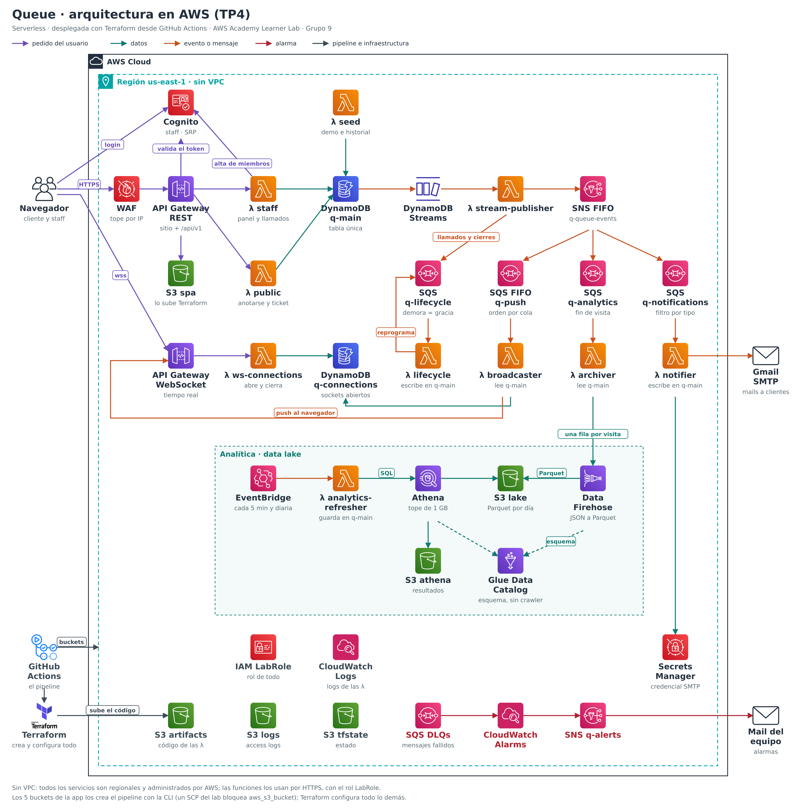

# Q — Architecture, Design and Decisions

How the system is built, as deployed for the Cuarta Entrega, and why. The design it was built from
is [arquitectura-serverless.md](historial/arquitectura-serverless.md) (in Spanish); where the build deviates
from it, the "Ajustes al diseño" table in [ROADMAP.md](historial/ROADMAP.md#ajustes-al-diseño) says so and
why. The previous architecture — Spring Boot on EC2 behind a load balancer, with PostgreSQL on RDS —
is in [`tp2/`](../tp2/) and in this file's git history.

| | |
|---|---|
| Domain rules | [domain-model.md](domain-model.md) |
| Endpoints and the WebSocket contract | [api-reference.md](api-reference.md) |
| Running the pipeline | [deployment.md](deployment.md) |
| Traps | [gotchas.md](gotchas.md) |

---

## 1. Purpose and scope

Q replaces a physical line with a virtual one. A customer scans a QR code, joins with a name and a
contact, and follows their place from their phone; staff call, serve and manage the line from a
panel. The scope is the MVP of *Funcionalidades 1-5* of the proposal: joining by QR, following the
wait, notifications, managing the line, and leaving or not showing up.

The Tercera Entrega asked for the architecture to be implemented with Terraform and deployed from a
GitHub Actions pipeline, into an AWS Academy Learner Lab account that the cátedra must be able to
reproduce from the README. Those two constraints — Terraform from a pipeline, and the lab's limits —
shape the deployment as much as the application does. The Cuarta Entrega added WAF in front of the
REST API, email-verified staff accounts with SRP sign-in, and the historical analytics: a data lake
loaded by Firehose, catalogued by Glue and summarised by Athena.

---

## 2. System overview



The diagram above is the deliverable: AWS Cloud, the region and every resource the Terraform
configuration creates, generated from [`diagrams/arquitectura.py`](diagrams/arquitectura.py). The
flow chart below is the same system reduced to its data flow.

```mermaid
flowchart LR
    browser([Browser]) -->|HTTPS| waf{{WAF}}
    waf --> rest[API Gateway REST]
    browser <-->|WSS| ws[API Gateway WebSocket]
    browser -->|sign up / sign in| cognito[Cognito]

    rest -->|/ and /{proxy+}| spa[(S3: site)]
    rest -->|/api/v1/public| public[λ public]
    rest -->|/api/v1/... Cognito authorizer| staff[λ staff]
    ws -->|$connect / $disconnect| wsconn[λ ws-connections]

    public --> main[(DynamoDB q-main)]
    staff --> main
    wsconn --> conns[(DynamoDB q-connections)]

    main -->|Streams, only new events| publisher[λ stream-publisher]
    publisher --> topic[[SNS FIFO q-queue-events]]
    publisher -->|delayed| lifecycleq[[SQS q-lifecycle]]
    topic --> pushq[[SQS FIFO q-push]]
    topic -->|filtered| notifq[[SQS q-notifications]]
    topic -->|visit ended| analyticsq[[SQS q-analytics]]

    pushq --> broadcaster[λ broadcaster]
    notifq --> notifier[λ notifier]
    lifecycleq --> lifecycle[λ lifecycle]

    broadcaster -->|post to connection| ws
    notifier -->|SMTP over TLS| gmail[Gmail]
    notifier -.->|reads the app password| secrets[(Secrets Manager)]
    lifecycle --> main

    analyticsq --> archiver[λ archiver]
    archiver --> firehose[Data Firehose]
    firehose -->|Parquet, one folder per day| lake[(S3: lake)]
    firehose -.->|schema| glue[(Glue Data Catalog)]
    schedule[EventBridge, every 5 min and daily] --> refresher[λ analytics-refresher]
    refresher -->|SQL| athena[Athena]
    athena -.-> glue
    athena --> lake
    refresher -->|daily aggregates| main
```

Two paths, and the line between them is the DynamoDB transaction:

* **Synchronous.** A request reaches `λ public` or `λ staff`, which reads the queue, applies the
  domain rules in memory, and writes everything that changed — including the events describing the
  change — in one transaction conditioned on the queue's version. The response goes back at once.
* **Asynchronous.** Everything else starts from those event items: the live push, the emails, the
  grace timer, releasing a closed queue, and loading the data lake. Consumers have independent queues and retries, so a
  downstream failure does not roll back the committed change. Delivery limits are described in §6.

### Components at a glance

| Component | Role | Why this and not something else |
|---|---|---|
| WAF | A per-IP rate limit on the public routes and AWS's managed rules, in front of the REST API | Stops a flood before it invokes a Lambda; the managed rules cover common web attacks without writing them |
| API Gateway REST | Serves the static site from S3 and the API on the same origin | CloudFront is blocked in the lab; this is the only HTTPS entry that can serve a private bucket. Same origin also means no CORS |
| API Gateway WebSocket | Holds the browsers' connections; Lambda only runs on connect, disconnect, and to push | Push without polling, and without a server holding sockets |
| 10 Lambdas, TypeScript on Node 22 | The API, the consumers, the analytics, the seed | Short cold starts without SnapStart; one language with the frontend; small single-file bundles |
| DynamoDB `q-main` | Every item but the users, in one table | Every operation is per queue; one partition per queue gives transactions over a queue's items and ordered reads by prefix |
| DynamoDB Streams | The source of every asynchronous action | Fires for committed writes; ordering is guaranteed per item |
| SNS FIFO + SQS | Fan-out, filtering and buffering per consumer | Each consumer gets its own queue, retries, DLQ and concurrency limit |
| Cognito | Staff accounts | Removes the hand-rolled login, password hashing and the JWT secret; API Gateway validates tokens without running a Lambda |
| Gmail SMTP | Notification emails | The lab denies SES to every role. Gmail's SMTP server delivers to any address, with the group's account and an app password |
| Secrets Manager | That app password, the only secret | Encrypted at rest and read with the lab's role; the pipeline writes the value, so it is in no file, plan or state |
| Data Firehose | Loads every finished visit into the lake, as Parquet, one folder per day | Managed batching and JSON-to-Parquet conversion; no cluster, pay per GB |
| Glue Data Catalog | The schema of the visits table | Firehose converts with it and Athena reads with it; partition projection makes new days visible without a crawler |
| Athena | Summarises the lake by establishment, day and queue | Pay per query on data already in S3. Redshift would be a cluster running all day for one query every five minutes |
| EventBridge | Runs the analytics refresher: the last days every five minutes, the whole window once a day | The serverless way to schedule a function |
| S3 | The site, the function bundles, the data lake, Athena's results, and the access logs of the other four | Private buckets, as the TP2's correction asked |
| CloudWatch | Logs of every function; alarms on every DLQ, on the push queue's age, on the stream's failures and lag, on the analytics refresher's errors and on Firehose's failed deliveries | Built in; the alarms publish to an SNS topic |

**There is no VPC.** Nothing in the design needs one: DynamoDB, SNS, SQS, Secrets Manager and Cognito are
reached over AWS's public endpoints with IAM, and there is no database instance or server to
isolate. A VPC would require designing outbound access to these endpoints and Gmail, for example through
service endpoints and internet egress. This delivery has no component requiring private subnets;
a production account may still choose a VPC for network policy and egress controls.

---

## 3. Request lifecycles

### 3.1 A customer joins

1. The QR opens `/q/?id=<queueId>`. The page loads `GET /public/queues/{id}` and, as the party size
   changes, `GET …/availability?partySize=`.
2. `POST /public/queues/{id}/entries` reaches `λ public`. It first counts the request against the
   caller's IP for the current minute (a conditional counter item in `q-main`); past the limit, 429.
3. It reads the queue (`META`, lanes, active entries), runs `join`: validate the contact, choose the
   lane, check the lane's capacity and the queue's, take an order key at the end, mint the ticket.
4. One transaction writes the entry, its ticket and reference items, the queue's new version and the
   `ENTRY_JOINED` event. 201 with the ticket.
5. Asynchronously: the event reaches `q-push`, and `λ broadcaster` pushes the new board to staff
   watching the queue and the new ticket view to every waiting customer connected to it; it also
   reaches `q-notifications`, and `λ notifier` emails `TICKET_CREATED` with the ticket link.

### 3.2 Staff call the next customer

1. `POST /queues/{id}/calls` arrives with the Cognito token. API Gateway's authorizer validates it;
   `λ staff` reads the caller's membership of the queue's establishment.
2. `callNext` expires any due grace first, then the selector picks who is next under the queue's
   call strategy and lanes. The entry becomes `CALLED` with `graceExpiresAt`.
3. One transaction, conditioned on the version. If another call won the race, it re-reads and picks
   again — so two staff pressing "call" at once call two different people.
4. Asynchronously: `λ stream-publisher` sees `ENTRY_CALLED` and, besides publishing it, sends a
   message to `q-lifecycle` delayed until the grace period ends. The board and every ticket are pushed;
   the notifier sends `YOUR_TURN`, and any threshold alerts that the movement triggered.

### 3.3 A grace period expires

1. The delayed message reaches `λ lifecycle`. SQS delays at most 15 minutes, so a longer grace is
   re-scheduled until it is due.
2. `lifecycle` runs `expireDue` on the current state: if the person was served a second earlier, or
   a read already expired them, there is nothing to do. Otherwise the queue's no-show policy applies
   and the transaction records it.
3. The events flow as before: pushes, and a `NO_SHOW` email explaining what the policy did.

### 3.4 Staff close a queue

Closing is immediate and atomic: the status changes and `QUEUE_CLOSED` is recorded with the number of
people still inside. `stream-publisher` sends it to `q-lifecycle` with no delay, and `λ lifecycle`
releases everyone as `LEFT`, 24 per transaction, batch after batch until the line is empty. Each
release reaches the notifier, which tells each customer the queue closed.

---

## 4. The functions

| Function | Trigger | Does |
|---|---|---|
| `public` | API Gateway REST | The customer's routes and the health check: queue view, availability, QR, join, ticket, leave, notifications |
| `staff` | API Gateway REST, behind the Cognito authorizer | The whole panel: establishments, members, queues, lanes, board, calls, entries, metrics, WebSocket tickets |
| `ws-connections` | API Gateway WebSocket `$connect`, `$disconnect` | Validates the customer's ticket or the staff member's one-time ticket, and records the connection |
| `stream-publisher` | DynamoDB Streams on `q-main`, filtered to new event items | Publishes each event to SNS; schedules grace expiry and queue release on `q-lifecycle` |
| `broadcaster` | SQS FIFO `q-push` | Pushes the current board and tickets to the connections watching a queue |
| `notifier` | SQS `q-notifications` | Decides which notifications are due and sends them, once each: through Gmail's SMTP server in the Learner Lab, which denies SES |
| `lifecycle` | SQS `q-lifecycle` | Applies due grace periods and releases closed queues in batches |
| `archiver` | SQS `q-analytics`, filtered to the events that end a visit | Builds the visit's fact row from the finished entry and sends it to Firehose |
| `analytics-refresher` | EventBridge: every five minutes, and once a day | Asks Athena for the daily aggregates — today and yesterday every five minutes, the whole 90 days once a day — and stores them in `q-main` for the panel |
| `seed` | Invoked by Terraform on apply | Loads the demo establishment, queues and lanes, idempotently, and the demo's visit history into the lake |

The split follows two cuts, and only two:

* **By trigger, which the platform imposes.** API Gateway is synchronous and does not retry; a
  stream blocks its shard until a batch succeeds; an SQS queue retries per message and needs its own
  visibility timeout and DLQ. Mixing two sources in one function means configuring for the worse of
  the two and coupling their failures: if email is down, the notifier's retries must not stop the push.
  So each queue has its own consumer.
* **By audience, inside the API.** Customers are anonymous, arrive in bursts when a QR is scanned,
  and only need a handful of routes; staff are few, authenticated, and use everything. Different
  exposure, different alarms, and the customer's path does not load the panel's code.

One function per endpoint was rejected: some 36 functions would each keep their own warm instances,
so most invocations would start cold, and the usual advantage — a least-privilege role per function —
does not exist in the lab, where every function runs as `LabRole`. Splitting by entity was rejected
because what changes together would be in different functions: calling someone writes the entry and
the queue's `META` in the same transaction.

Every function is built from `functions/src/handlers/<name>.ts` into its own bundle with esbuild. The
domain (`src/domain`) is pure TypeScript with no AWS in it; `src/persistence` turns what the domain
changed into DynamoDB writes.

---

## 5. Data

The full item and key layout is in [domain-model.md](domain-model.md#entities). The decisions that
shape it:

* **One partition per queue.** `QUEUE#<id>` holds the queue's `META`, its lanes and every entry, so a
  change to a queue is a transaction inside one partition, and the board is one query.
* **The sort key encodes the entry's state.** `W#<orderKey>` for waiting, `A#<entryId>` for called or
  being served, `F#<finishedAt>#<entryId>` for finished. The line is a prefix query already in order;
  the panel's live metrics are a range query on `F#`. Only the historical dashboard reads aggregates
  computed in advance (`ANALYTICS#`, one item per establishment and day), which Athena recalculates.
* **Order keys are fractional strings**, so inserting between neighbours never renumbers the line.
* **Events have their own partition per queue**, ordered by the queue's version, and expire after 30
  days through TTL. Only their insertion matters to the stream.
* **No counters.** Every change already reads the queue's active entries, so capacity is counted on
  what was read, under the same version. A stored count would be a second copy that can drift.
* **Two tables, not one.** `q-connections` holds one item per open WebSocket, with a `byQueue`
  index; it changes at a different rate, is never part of a queue's transaction, and its stream is
  not needed.

Both tables are on-demand, with point-in-time recovery on `q-main`, and no deletion protection,
because the cátedra has to be able to destroy everything.

---

## 6. Concurrency and correctness

### 6.1 Optimistic control per queue

DynamoDB has no locks, so the queue's `META` item carries a `version`. Every operation reads it with
the rest of the queue, decides in memory, and writes in one transaction that includes
`version = :read` as a condition on `META`. DynamoDB transactions are serialisable among themselves:
of two writers that read the same version, exactly one commits. The other gets
`TransactionCanceledException`, re-reads and decides again, up to 8 times with backoff; then the API
answers `409 CONCURRENT_MODIFICATION`, and nothing was written.

The races this covers — two and three staff calling at once, two customers joining at once, two
joins for the last place, a grace expiry while staff serve the person, a read crossing someone else's
commit — are tested against DynamoDB Local in `functions/test/integration/races.test.ts`.

### 6.2 The event is part of the change

Each operation's events are items in its own transaction. So an event exists if and only if the
change it describes committed: there is no "wrote the change, crashed before publishing" and no
"published, then the write failed". DynamoDB Streams guarantees ordering per item, not across all
event items of a queue. `stream-publisher` sorts each received batch by queue version and event key;
that does not establish global order across batches or shards. SNS uses the event id for its
five-minute deduplication window. Retries outside that window can deliver duplicates.

References: [DynamoDB Streams ordering](https://docs.aws.amazon.com/amazondynamodb/latest/developerguide/Streams.html)
and [SNS FIFO deduplication](https://docs.aws.amazon.com/sns/latest/dg/fifo-message-dedup.html).

### 6.3 Consumers decide from state

Consumers use the event as a trigger and re-read the current queue state rather than applying
blind deltas. This reduces the effects of duplicate or late events; it is not an end-to-end
exactly-once guarantee. Lifecycle checks what is currently due, and the notifier claims
`NOTIF#<type>#<cycle>` conditionally before sending. A failed claim can mean already sent, an active
lease, or an exhausted attempt budget.

SMTP delivery and marking the claim `SENT` are separate operations. If delivery succeeds and the
function stops before persisting `SENT`, a later retry can resend after the lease expires. The
application therefore cannot promise that a second email is impossible.

### 6.4 Failure handling

| Where | On failure |
|---|---|
| Stream → `stream-publisher` | Reports the first pending stream sequence number; retries are bounded at 5 with a maximum record age of one hour. Discarded-invocation metadata goes to `q-stream-failures`, with an alarm. The source stream retains records for 24 hours |
| SQS consumers | Return reported failures with `ReportBatchItemFailures`. Repeatedly failed messages can reach the DLQ after the redrive limit; errors caught and treated as success are acknowledged instead |
| `q-push` | Alarms on oldest-message age above 10 seconds, evaluated with 60-second periods. This detects backlog, not each lost WebSocket send. Per-connection send errors are logged and swallowed by the broadcaster |
| Notifications | Failed sends are recorded and reported for SQS retry, with a separate five-attempt claim budget. An exhausted or active claim is skipped; not every undelivered notice necessarily becomes a DLQ message |

---

The stream-failure queue retains metadata for 14 days; it is not a full-payload archive or an
automatic replay mechanism. Recovery must locate the source record while it remains in the stream,
or reconstruct the domain event from its stored event item if still available. No replay tool is
implemented. See [AWS failure destinations](https://docs.aws.amazon.com/lambda/latest/dg/services-dynamodb-errors.html).

## 7. Realtime

The browser opens a WebSocket to the second API Gateway API with its credential in the URL — a
customer's ticket token, or a staff member's one-time ticket from `POST /queues/{id}/ws-tickets` —
because a browser cannot set headers on a WebSocket. `λ ws-connections` validates it on `$connect`
and records the connection with the queue it watches; the queue is fixed at connect time, so there is
no subscribe route.

On every event of a queue, `λ broadcaster` (fed by the FIFO `q-push`, grouped by queue so events for
one queue are processed in SNS publication order, one batch at a time) reads the queue's current state once and
posts to each connection what it may see: staff get the board, each customer only their own ticket.
A connection that API Gateway reports gone is deleted; connections whose `$disconnect` never arrived
expire through TTL.

The first view of every page comes over REST, not the socket, because a socket cannot report a
status code. On every reconnection the page reloads over REST whatever it missed. API Gateway closes
connections after ten idle minutes, so the page pings every five (answered by API Gateway with a mock
integration, no Lambda), and after two hours in any case, so it reconnects with backoff. While the
socket is down, the page polls.

A transient `PostToConnection` error need not close the browser socket. The broadcaster currently
logs that error and acknowledges the message, while the browser disables polling on an open socket.
The view may remain stale until another successful push, reconnection or reload. This is a known
implementation limitation, not a recovery guarantee.

---

## 8. Security model

### 8.1 Two audiences, two models

* **Staff** sign up and sign in against Cognito from the site's own pages, with SRP
  (`USER_SRP_AUTH`, the only flow the client allows) and no hosted UI. Sign-up confirms the email with
  a code Cognito sends. The id token goes in `Authorization` and API Gateway's Cognito authorizer
  validates it before any function runs. Tokens last one hour and the browser renews them with the
  refresh token during a 12-hour session.

  **Why the Lambda callback workaround from class does not apply.** That workaround exists because
  Cognito's hosted UI redirects back with the tokens (or a `code`) to a callback URL that must be
  HTTPS, and a site on S3 website hosting is plain HTTP; a `/callback` behind API Gateway and a Lambda
  bridges the two. Neither condition holds here. There is no redirect: the sign-in form is ours and
  calls Cognito's `InitiateAuth` and `RespondToAuthChallenge` directly over TLS, and Cognito returns the tokens in that response, so
  there is no callback URL and no `code` to exchange. And the site is not on HTTP: API Gateway serves it
  at a fixed `https://…execute-api…/prod/` address, so even with the hosted UI the callback could point
  straight at one of our pages. What we give up without the hosted UI is its ready-made social sign-in
  and MFA and recovery screens; in exchange, the password never leaves the browser: SRP proves it to
  Cognito without sending it, and it never passes through our functions. The id token, not the access token, goes to the API because the Cognito
  authorizer validates it as is; the access token would need OAuth scopes configured on every method.
* **Customers** have no account. Their ticket token — unguessable, in the link they are emailed — is
  their whole credential, and it only shows their own place in line.

### 8.2 Authorisation is membership, read per request

The token says who the caller is, not what they may do. `λ staff` reads the caller's membership of
the establishment that owns the queue or entry **it read** — never of an id the client sent — on
every request. Removing someone takes effect on their next request, not their next sign-in. Owners
configure; staff operate.

### 8.3 One secret

Cognito replaced the JWT secret and password hashing. DynamoDB, SNS, SQS and Secrets Manager are
reached with the lab's IAM role. There is no database password and no API key.

There is one secret, forced by the lab: because it denies SES, emails go through Gmail's SMTP server,
which needs an app password of the group's account. It is treated as the TP2's correction asked
("falta encriptar"): it lives only in a GitHub secret and, encrypted at rest, in Secrets Manager.
Terraform creates the secret empty and the Apply job writes the value with the AWS CLI after the
apply, because a value set through Terraform would be in plain text in the saved plan (a
downloadable workflow artifact) and in the state. The notifier reads it when it sends, and it only
travels over TLS. The lab session keys are also held in GitHub secrets. Separately, Terraform generates a demo
staff password and stores it in state and saved plans. `sensitive = true` hides ordinary output
but does not remove that value from those files. Access to state and artifacts must be controlled.

### 8.4 Abuse limits

WAF, in front of the REST API, blocks an IP that sends more than 300 requests a minute to the public
routes, and applies AWS's managed rules against common web attacks, known bad inputs and IPs with a
bad reputation. Behind it, API Gateway throttles every route below what the lab's Lambda concurrency can serve, so a burst gets
429 instead of failing invocations. The two routes anyone can write to — join and leave — have a lower
limit, and joining is also limited per IP per minute in the function. The site's files have a higher
limit of their own: they invoke no Lambda, and a crowd scanning the same QR requests hundreds of them
at once.

### 8.5 Residual risks, stated plainly

* The staff token is in `localStorage`, readable by any script on the page. A static site on API
  Gateway has no server of its own to hold an `HttpOnly` cookie.
* Per-function least privilege is impossible in the lab: every function runs as `LabRole`.
* The WebSocket API cannot be associated with WAF. Connecting already requires a ticket token or a
  one-time staff ticket.
* The per-IP join limit trusts API Gateway's view of the source IP, which is right, but many
  customers behind one NAT share it.

---

## 9. Error model

Every error the functions return is RFC 7807 `application/problem+json` with a stable `code`, the
same contract the Java API had, so the frontend did not change. Domain errors carry their kind
(validation 400, forbidden 403, not found 404, conflict 409); a cancelled transaction becomes 409
`CONCURRENT_MODIFICATION`; anything else is a logged 500. Null fields are omitted. The list of codes
is in [api-reference.md](api-reference.md#errors).

---

## 10. Frontend

Detail lives in [frontend.md](frontend.md); the architectural decisions are here.

**Static export.** `next build` with `output: 'export'` produces plain HTML, CSS and JS, uploaded by
Terraform to the site bucket and served by API Gateway. No Next.js server runs anywhere. A static
export cannot pre-render pages for ids that do not exist at build time, and the site has no rewrite
rules, so every id travels in the query string: `/q/?id=…`, `/t/?token=…`, `/panel/queue/?id=…`.

**Runtime configuration.** The Cognito ids and the WebSocket address only exist after the apply, and
the site is built before it. Terraform writes them to `config.json` next to the site, and the page
reads it once per load — so one build works in any account.

**First-party data layer.** No query library, no state library, no component library: a typed API
client that turns problem responses into an `ApiError` with the `code`; a hook that keeps one resource
in sync (REST first, then the WebSocket, polling only while the socket is down); and the Cognito calls
over `fetch`.

**Language.** English and Spanish. A customer's language is a property of their visit: the page sends
it with the join, it is stored on the entry, and every email to that customer is rendered in it.
English is the source of truth and Spanish is typed as a complete record of it, so a missing
translation is a compile error.

---

## 11. Testing strategy

**Two tiers of tests**, run on every push by the pipeline:

* **Unit** (`functions/test/domain`, `handlers`, `notifications`) — the pure rules: ordering keys,
  the selector, estimation, lanes, requeue, metrics; plus the stream publisher and the Gmail mailer
  with fake clients. Fast and exhaustive.
* **Integration** (`functions/test/integration`) — the handlers end to end with API Gateway events
  built by hand, the stores, the stream consumers, and the races, all against a real DynamoDB Local
  started by Testcontainers. Real because the conditional transactions, the key order and the stream
  are exactly what an in-memory fake would get wrong. Only Cognito is faked.

After every apply, the pipeline's **smoke test** exercises the deployed system: health, the site, the
404 page, `config.json`, and a customer joining, reading their ticket and leaving with the WebSocket
open until the push arrives.

The frontend has no automated tests; it is verified by hand against a deployed stack.

---

## 12. Deployment

Terraform, run only by GitHub Actions on the pull request: validate and build on every push, plan
with the lab's credentials, apply the saved plan after an approval, destroy with a label. The state
is in an S3 bucket per account with native locking. Three of our own modules (`private-bucket`,
`lambda-function`, `queue-with-dlq`) and one external (`terraform-aws-modules/dynamodb-table`). The
pipeline creates the five S3 buckets itself, because the lab denies a read the provider needs after
creating one. Procedure in [deployment.md](deployment.md).

---

## 13. Decision log

| Decision | Chosen | Rejected, and why |
|---|---|---|
| Compute | Lambda | EC2 behind a load balancer (the TP2): always-on cost, NAT, a database instance, and per-instance state for live updates |
| Function language | TypeScript on Node 22 | Java with SnapStart, as the design proposed: sub-second cold starts only with snapshots, a second language, and Maven modules to share the domain. The domain was ported instead, with its tests |
| Database | DynamoDB, single table | RDS: an instance billing idle, a VPC and a password. Every access is per queue, which fits a partition per queue |
| Concurrency | Optimistic, a version on the queue | Locks do not exist in DynamoDB; a lock item would add a write and a failure mode |
| Ordering | Fractional string keys | Integers 1000 apart (the TP2): renormalising rewrites the whole line, and a transaction takes 100 items |
| Publishing events | Event items in the change's transaction, read from the stream | Publishing after the write: loses events on a crash in between, or announces changes that rolled back |
| Notifications | Decided from state by a consumer | Inside the staff transaction (the TP2): one movement can make dozens cross a threshold, which does not fit in a transaction |
| Live updates | API Gateway WebSocket | Server-Sent Events: need a process holding the connection. Polling alone: slower and more invocations |
| Staff auth | Cognito, validated by API Gateway | A Lambda authorizer and our own JWT: a secret to store, password hashing to maintain, and an invocation for every request the cache misses |
| Staff sign-in | Our own form, SRP against Cognito | The hosted UI with a `/callback` Lambda (the workaround from class): it solves an HTTP site needing an HTTPS redirect, and ours is already HTTPS with no redirect at all (§8.1) |
| Channels | Email, through Gmail's SMTP server in the Learner Lab (SES where allowed) | SES alone: the lab denies it to every role, so nothing would be delivered. Web Push, which the design proposed: a service worker and VAPID keys. SMS: sandboxed |
| Serving the site | API Gateway from a private S3 bucket | CloudFront: blocked in the lab. S3 website hosting: needs a public bucket, and plain HTTP |
| Grace expiry | Delayed SQS message, plus lazy on read and write | Only lazy (the read path): a queue nobody looks at would never move. Only the timer: a page could show a call the clock already invalidated |
| Bucket creation | The pipeline, with the AWS CLI | `aws_s3_bucket`: fails in the lab, the SCP denies a read the provider makes after creating it |
| Function split | By trigger, then by audience in the API | One per endpoint, one for everything, by entity, CQRS (§4) |
| Edge protection | WAF on the REST API | Only API Gateway throttling: global per route, it cannot single out one abusive IP |
| Historical analytics | A data lake (Firehose, S3 in Parquet, Glue) queried by Athena | Scanning `q-main`: it is modelled per queue, not for months across every queue. Redshift: a cluster billing all day. QuickSight: the dashboard is per establishment and lives in the panel |
| Serving the dashboard | Daily aggregates precomputed in DynamoDB | Querying Athena on every page load: seconds per answer and billed per data scanned. Aggregates are sums, counts and histograms, so any range is the sum of its days |

---

## 14. Known limitations

* **The lab's credentials expire** with each session and have to be loaded into the secrets by hand.
  A normal account would use an OIDC role, which the lab cannot create.
* **Emails depend on a Gmail account.** The lab denies SES, so they go out through Gmail's SMTP
  server: subject to Gmail's daily limit for a personal account, with bounces landing in the group's
  inbox, and simulated in the notifier's log if the account is not configured.
* **No SMS.** A customer who leaves only a phone number gets no notifications.
* **Every deployment changes the site**: the Next.js build ID is random, so about 75 objects are
  re-uploaded, and the REST API redeployed, even when the frontend did not change.
* **One race test is flaky**, about once in 30 runs, without a reproduced cause; it is not the
  optimistic control, which is what it tests.
* **The analytics dashboard lags by minutes**: Firehose writes every 60 seconds and the refresher runs
  every five minutes. A fact that reaches a day older than yesterday — a duplicate delivery, or the demo
  history — waits for the daily full run, except right after the demo history is loaded, when the seed
  asks for full runs for 30 minutes.
* **No frontend tests.**
